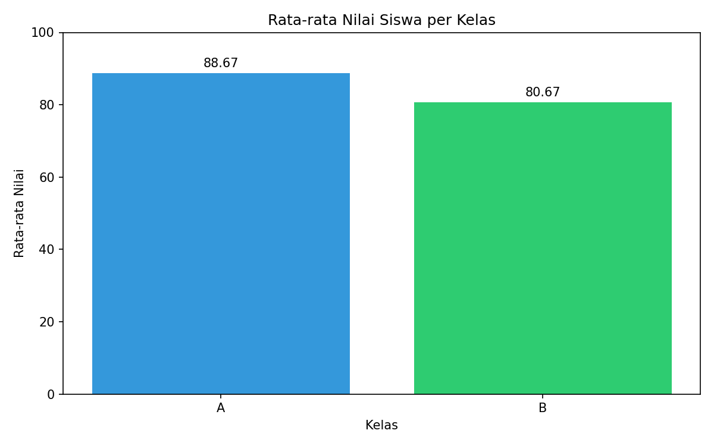

# Student Performance Data Analyzer

A Python data analysis project using Pandas and Matplotlib.

## Overview

This project demonstrates a basic data analysis workflow:
data inspection, data cleaning, statistical analysis,
visualization, and exporting results.

The dataset is simulated for educational purposes.

## Technologies

- Python 3
- Pandas
- Matplotlib

## Features

- Read student data from CSV
- Detect missing values and duplicate rows
- Remove exact duplicates
- Fill missing scores using the overall mean
- Calculate class averages and student rankings
- Export cleaned data and summary statistics
- Generate a bar chart comparing class averages

## Dataset

Initial dataset:
- 9 rows and 3 columns
- 2 missing scores
- 1 duplicate row

After cleaning:
- 8 rows
- 0 missing scores
- 0 duplicate rows

Missing scores are filled using the mean of available
scores after duplicate removal.

Note: Mean imputation is a learning exercise and may
not be appropriate for real student assessments.

## Results

| Metric | Result |
|---|---:|
| Total students | 8 |
| Overall average | 84.67 |
| Class A average | 88.67 |
| Class B average | 80.67 |
| Highest score | 95 |
| Lowest score | 70 |

Top 3 students:
1. Citra - 95
2. Eka - 90
3. Hani - 88

## Visualization

## How to Run

Install dependencies:

    python3 -m pip install pandas matplotlib

Run from the repository root:

    python3 projects/02-student-performance-analyzer/main.py

## Project Files

- main.py
- data_siswa.csv
- data_bersih.csv
- ringkasan_kelas.csv
- grafik_rata_rata_kelas.png
- README.md

## Learning Outcomes

- Data inspection
- Missing value handling
- Duplicate removal
- Statistical analysis
- Data visualization
- CSV export

## Author

GitHub: Isrock369

Part of my Machine Learning Journey.

